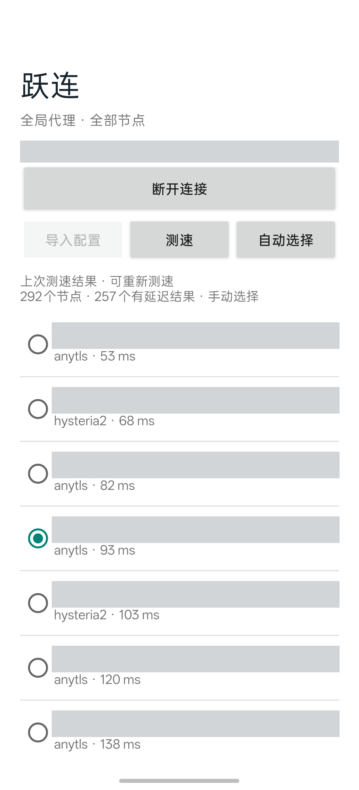

# HopLink · 跃连

HopLink is an Android global proxy client. It puts node selection, latency tests, and connection controls on one screen.

[中文 README](README.md)

## Features

- **One screen:** Import a configuration, review nodes, and connect or disconnect the VPN.
- **Sort by latency:** Test nodes in parallel and see results as they arrive. Timed-out and untested nodes appear at the end.
- **Automatic or manual selection:** By default, HopLink selects the tested node with the lowest latency. Later tests do not override a manual selection.
- **Stop a test at any time:** Stopping a test keeps the displayed results and current node. You can disconnect the VPN while a test is running.
- **Run independently:** Use Wi-Fi or mobile data without keeping a computer, ADB, or another proxy app connected.
- **Keep configuration on the device:** Imported configuration is stored in the app's private directory. It is not packaged in the APK or uploaded to a conversion service.

## Interface



The screenshot hides node names, connection status, and the phone's status bar.

## Installation

1. Download the arm64 APK from [Releases](https://github.com/Henry2012/HopLink/releases).
2. Install the APK on a phone running Android 10 or later.
3. Open HopLink. Tap **导入配置** (Import configuration), then choose a Clash YAML file containing a `proxies` list.
4. Wait for the test to finish, or select a node manually.
5. Tap **连接** (Connect), then approve the Android VPN permission request.

The first import starts a latency test automatically. During a test, tap **停止测速** (Stop test) to cancel it. Tap **自动选择** (Automatic selection) to select the tested node with the lowest latency again.

If you placed a copy of the configuration in the phone's Downloads folder, delete that copy after import. HopLink does not update subscriptions automatically. Import the configuration again when the provider changes its nodes.

## Latency and global mode

HopLink measures the time for each node to receive an HTTP 204 response from `https://cp.cloudflare.com`. Each test has a 5-second timeout, with up to 16 tests running in parallel. Results reflect network conditions at the time of the test. A successful test does not guarantee access to every website or service.

When connected, HopLink sends IPv4, IPv6, and DNS traffic through the local VPN. The app's own connections to nodes bypass the VPN to prevent a routing loop. ICMP is not forwarded directly, so do not use `ping` to judge node latency.

## Build

The current project uses Android SDK 35, JDK 17, Gradle 8.9, AGP 8.7.3, Go 1.26.5, and Android NDK r27c.

```sh
bash scripts/test.sh
bash scripts/build.sh
```

The build script currently contains paths from the development machine. Adjust the SDK, JDK, and Gradle paths for your environment and install the NDK before building. The build creates a signing key under `.tools`. Keep that key safe: you need the same signing key to update an installed package. Do not publish the key or configuration files containing node credentials.

## Verification

Node import, latency testing, cancellation, VPN connection, and disconnection were tested on an OPPO Find X8s+ running Android 17. The user also confirmed that YouTube was accessible over mobile data with Wi-Fi disabled. The Codex, Grok Bot, and X web entry pages were observed to load. These checks do not verify every account feature of those services.

## License

The project is licensed under GPL-3.0. Its proxy core uses [Mihomo](https://github.com/MetaCubeX/mihomo). The included source comes from the branch used by FlClash; its commit and license are retained in `third_party/mihomo`. The APK includes the core license.
