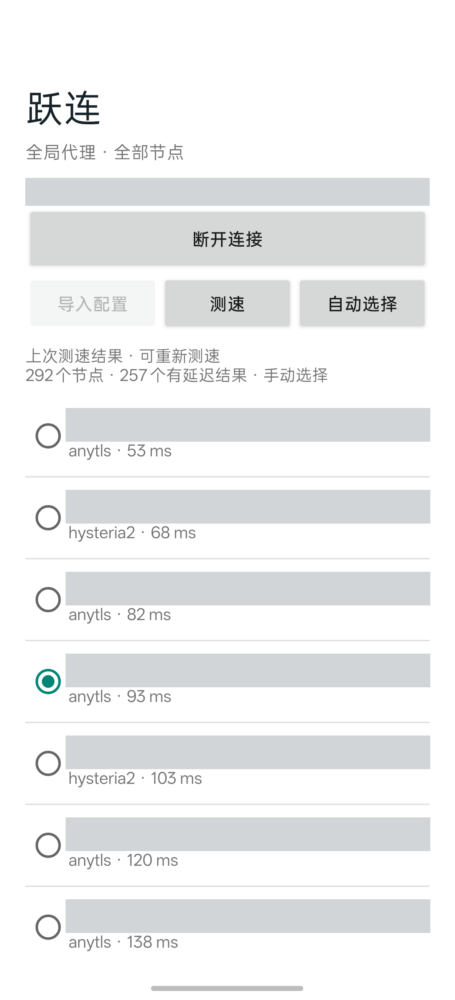

# 跃连 · HopLink

[English README](README.en.md)

跃连是一个 Android 全局代理客户端。它把节点列表、测速和连接控制放在同一页面，适合希望自己选择节点的用户。

## 特色

- **一页操作**：导入配置、查看节点、连接或断开 VPN。
- **按延迟排序**：并发测速，结果随完成顺序显示；超时和未测节点排在后面。
- **自动或手动选择**：默认选取已测节点中延迟最低的节点；手动选择后，后续测速不会覆盖该选择。
- **随时停止测速**：停止后保留已显示结果和当前节点；测速期间也可以断开 VPN。
- **手机独立运行**：使用手机的 Wi-Fi 或移动数据，不需要电脑、ADB 或其他代理 App 保持连接。
- **配置保存在本机**：导入的配置保存在应用私有目录，不会打包进 APK，也不会上传到转换服务。

## 界面



截图已遮挡节点名称、连接状态和手机状态栏。

## 安装

1. 从 [Releases](https://github.com/Henry2012/simple-node-vpn/releases) 下载适用于 arm64 的 APK。
2. 在 Android 10 或更新版本的手机上安装 APK。
3. 启动跃连，点击 **导入配置**，选择包含 `proxies` 节点列表的 Clash YAML 文件。
4. 等待测速完成，或手动选择一个节点。
5. 点击 **连接**，在 Android 系统弹窗中允许 VPN 连接。

首次导入后会自动测速。再次测速时，点击 **停止测速** 可中止当前任务。点击 **自动选择** 可恢复按最低延迟选节点。

如果导入文件放在手机的 Downloads 目录，导入完成后请删除该副本。跃连不会自动更新订阅；服务商更新节点后，需要重新导入配置。

## 测速与全局模式

跃连通过每个节点访问 `https://cp.cloudflare.com`，以 HTTP 204 响应时间作为延迟。每个节点最多等待 5 秒，同时测试不超过 16 个节点。结果反映的是测速时的网络状态，不能保证所有网站和服务都可用。

连接时，跃连将 IPv4、IPv6 和 DNS 流量交给本机 VPN 处理。应用自身与节点的连接不经过 VPN，以避免循环。ICMP 不直接转发，因此请勿用 `ping` 结果判断节点延迟。

## 构建

本项目当前使用 Android SDK 35、JDK 17、Gradle 8.9、AGP 8.7.3、Go 1.26.5 和 Android NDK r27c。

```sh
bash scripts/test.sh
bash scripts/build.sh
```

构建脚本目前包含开发机的 SDK、JDK 和 Gradle 路径。请先根据自己的环境调整路径，并准备 NDK。构建时生成的签名密钥保存在 `.tools` 中；请妥善保存，后续更新同一安装包需要使用相同的签名密钥。不要公开密钥或包含节点凭据的配置文件。

## 验证范围

已在 OPPO Find X8s+、Android 17 上验证节点导入、测速、停止测速、VPN 连接与断开。用户还确认：关闭 Wi-Fi 后，手机通过移动数据仍可访问 YouTube。Codex、Grok Bot 和 X 的网页入口已验证可加载；这些检查不代表各服务的所有账户功能都已验证。

## 许可证

项目基于 GPL-3.0 发布。代理内核使用 [Mihomo](https://github.com/MetaCubeX/mihomo)；随附源码来自 FlClash 使用的分支，具体提交及许可证保存在 `third_party/mihomo`。APK 随附内核许可证。
